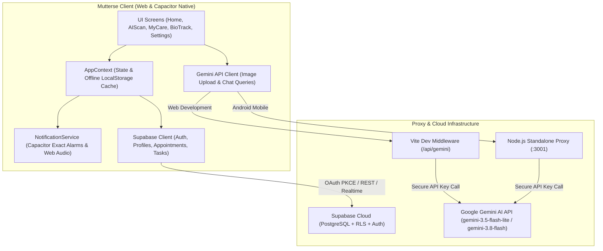

# Mutterse — Gentle, Intelligent Maternal Care INSTALL Mutterse-Debug.apk FOR THE APK zip.zip for the code 

[](LICENSE)
[](https://react.dev/)
[](https://www.typescriptlang.org/)
[](https://vite.dev/)
[](https://capacitorjs.com/)
[](https://tailwindcss.com/)
[](https://supabase.com/)
[](https://aistudio.google.com/)

> **Mutterse** is a privacy-first, cross-platform maternal healthcare companion application engineered for Android and the modern web. It provides expectant mothers with compassionate gestational tracking, intelligent AI prescription and medicine safety scanning, clinical appointment reminders, exact medication alarms, and comprehensive birth preparation.

---

## 📋 Table of Contents

- [Maternal Care Mission & Objectives](#-maternal-care-mission--objectives)
- [Key Features](#-key-features)
- [Technology Stack](#-technology-stack)
- [System Architecture & Workflow](#-system-architecture--workflow)
- [Repository Structure](#-repository-structure)
- [Prerequisites](#-prerequisites)
- [Quick Start & Installation](#-quick-start--installation)
- [Environment Configuration](#-environment-configuration)
- [Supabase Setup & Database Schema](#-supabase-setup--database-schema)
- [Google Authentication (OAuth)](#-google-authentication-oauth)
- [AI Medicine Scanner & Chat Setup](#-ai-medicine-scanner--chat-setup)
- [Running in Development](#-running-in-development)
- [Building for Production Web](#-building-for-production-web)
- [Android Native Build (Capacitor)](#-android-native-build-capacitor)
- [Screenshots & UI Walkthrough](#-screenshots--ui-walkthrough)
- [Known Limitations](#-known-limitations)
- [Privacy & Security Considerations](#-privacy--security-considerations)
- [Future Roadmap](#-future-roadmap)
- [License](#-license)

---

## 🌸 Maternal Care Mission & Objectives

Pregnancy is one of the most transformative times in life, yet navigating medications, prenatal visits, laboratory screenings, and changing body signals can be overwhelming.

**Mutterse** was created to address maternal anxieties with clarity, dignity, and calm:
- **Demystify Medication Safety**: Eliminate the uncertainty of over-the-counter and prescribed medications using intelligent multimodal computer vision that cross-references pregnancy contraindications and active ingredients.
- **Support Adherence with Dignity**: Ensure prenatal vitamins, iron supplements, and hydration goals are met through exact, battery-resilient alarms and personalized reminders.
- **Bridge Clinical Care**: Provide structured antenatal visit schedules, risk observations, lab result tracking, and quick access to assigned midwives, doctors, and labor & delivery triage lines.
- **Empower Preparedness**: Help mothers define their birth plans, organize hospital bags, track fetal kick counts, and designate emergency contacts.

---

## ✨ Key Features

### 1. Gestational Tracker & Fetal Milestones (`HomeScreen`)
- **Live Gestational Calculator**: Accurately computes gestational weeks and days from Last Menstrual Period (LMP) or Estimated Due Date (EDD).
- **Fetal Size Analogy**: Visualizes baby size milestones using intuitive comparisons (e.g., *Papaya*, *Eggplant*).
- **Interactive Kick Counter**: Session-based fetal movement tracker with persistent count and elapsed time.
- **Emergency Action Card**: Direct one-tap call and dispatch to labor & delivery 24/7 triage and designated emergency contacts.

### 2. Mutterse AI Vision & Medicine Scanner (`AIScanScreen`)
- **Multimodal Camera & Upload**: Integrates `@capacitor/camera` for direct camera capture on mobile and drag-and-drop image upload on desktop.
- **AI-Powered Label Analysis**: Uses Google Gemini multimodal vision (`gemini-3.5-flash-lite`, `gemini-3.5-flash`, and `gemini-3.8-flash` with automatic fallback) to extract:
  - Medication brand and generic title
  - Active chemical ingredients and strengths
  - Standard pregnancy and lactation contraindications
  - Legibility verification and confidence notes
- **Visual Safety Status**: Color-coded badges indicating *Safe*, *Caution*, or *Consult Doctor*.
- **Quick-Schedule Integration**: Instantly convert scanned medication dosages into active reminder notifications.

### 3. Ask Mutterse AI Midwife Chat (`AskMutterseAIChat`)
- **Context-Aware Assistance**: Chat interactively with an AI maternal health assistant that maintains conversational context and references recently scanned medications.
- **Midwife Persona**: Responds in a calm, empathetic tone with clear clinical guidance and reminders to consult licensed healthcare providers.

### 4. Maternal Care Coordination (`MyCareScreen` & `RemindersView`)
- **Antenatal Appointment Manager**: Schedule, reschedule, and mark routine ANC visits, ultrasound scans, blood glucose screenings, and postpartum follow-ups.
- **Daily Care Checklist**: Checklist for prenatal vitamins, hydration, walking, and pelvic floor routines.
- **Exact Alarms & Notifications**: Resilient local notification engine supporting native Android 12+ exact alarms (`SCHEDULE_EXACT_ALARM`) and Web Notification API / Audio chimes on desktop.
- **Birth-Readiness Plan**: Centralized registry for delivery hospital, chosen birth plan (Natural Vaginal, C-Section, Water Birth), primary partner contact, doula details, and health insurance policy info.

### 5. Maternal Biomarkers (`BioTrackScreen`)
- **Vitals Tracking**: Log daily systolic/diastolic blood pressure, resting pulse, and hydration intake.
- **Pelvic Floor & Exercise Logger**: Track guided Kegel routines and light maternal fitness.
- **Lab Results Archive**: Store obstetric panel results, reference ranges, and provider notes.

### 6. Authentication & Instant Demo Mode (`LoginPage`)
- **Flexible Sign-In**: Supabase-backed Email/Password authentication and Google OAuth.
- **One-Click Demo Mode**: Experience the full application immediately with rich synthetic profiles and mock clinical data without connecting an external database.

---

## 🛠 Technology Stack

| Layer | Technologies | Description |
| :--- | :--- | :--- |
| **Frontend Framework** | **React 19**, **TypeScript 6** | Modern functional UI with hooks, strict typing, and context state |
| **Build & Tooling** | **Vite 8**, **Tailwind CSS 4**, **PostCSS** | High-speed ESM development server, modern CSS engine, and tree-shaking |
| **Mobile Runtime** | **Capacitor 8** | Native Android bridge with native camera, exact alarms, and status bar plugins |
| **Backend & Proxy** | **Node.js (ESM)** | Embedded Vite middleware plugin and standalone proxy server (`server/index.js`) |
| **Database & Auth** | **Supabase (PostgreSQL 15)** | Relational storage with Row-Level Security (RLS) and OAuth PKCE |
| **Artificial Intelligence** | **Google Gemini API** (`@google/genai`) | Multimodal vision analysis and contextual conversational reasoning |
| **Icons & Typography** | **Lucide React**, **Google Fonts** | Newsreader, Plus Jakarta Sans, and Google Material Symbols Outlined |
| **Code Quality** | **Oxlint**, **Playwright** | High-performance linter and end-to-end integration test runner |

---

## 🏗 System Architecture & Workflow



### Application Lifecycle & Data Synchronization
1. **Bootstrap**: The application loads offline data from `localStorage` immediately, preventing white-screen delays.
2. **Authentication**: If authenticated with Supabase, user profiles and appointments sync bi-directionally with PostgreSQL.
3. **AI Vision Workflow**: The camera captures a medication label -> image base64 is transmitted to `/api/gemini/scan` -> server proxy validates the payload and invokes Gemini with a structured JSON schema -> structured safety evaluation is returned to the UI.
4. **Alarm Scheduling**: Dosage recommendations can be scheduled with one tap, registering Android system alarms via Capacitor's native alarm manager.

---

## 📁 Repository Structure

```
Mutterse-GitHub-Ready/
├── android/                         # Capacitor Android native project
│   ├── app/                         # Android application module
│   │   ├── src/                     # AndroidManifest.xml, Java sources & resources
│   │   ├── build.gradle             # App-level Gradle configuration
│   │   ├── capacitor.build.gradle   # Capacitor plugin bindings
│   │   └── proguard-rules.pro       # Code obfuscation & optimization rules
│   ├── gradle/                      # Gradle wrapper distribution
│   ├── build.gradle                 # Root Android build script
│   ├── capacitor.settings.gradle    # Capacitor native settings
│   ├── settings.gradle              # Gradle project definitions
│   └── variables.gradle             # Android SDK & dependency version variables
├── public/                          # Static web assets
│   ├── app-wallpaper.png            # Application background wallpaper
│   ├── favicon.svg                  # Brand favicon
│   └── icons.svg                    # SVG symbols
├── server/                          # Gemini AI Server Proxy
│   ├── index.js                     # HTTP server & request routing for /api/gemini
│   ├── geminiService.js             # @google/genai client with multi-model fallback
│   └── index.d.ts                   # Server module typings
├── src/                             # Complete React application source code
│   ├── assets/                      # Application brand illustrations & images
│   ├── components/                  # React modular components
│   │   ├── auth/                    # LoginPage and authentication styles
│   │   ├── biotrack/                # Maternal biomarker and lab tracking
│   │   ├── care/                    # Appointments, care tasks, and reminders view
│   │   ├── common/                  # Reusable UI primitives, modals, toasts, illustrations
│   │   ├── home/                    # Dashboard, gestational timeline, and kick counter
│   │   ├── layout/                  # BottomNav (mobile) and DesktopNav (desktop)
│   │   ├── profile/                 # Profile setup and obstetric records
│   │   ├── scanner/                 # Camera scanner and AskMutterseAIChat
│   │   └── settings/                # Preferences, notifications, and demo mode toggle
│   ├── context/                     # AppContext (global state & offline synchronization)
│   ├── data/                        # mockData.ts (baseline clinical datasets & fallbacks)
│   ├── services/                    # Integration clients
│   │   ├── geminiApi.ts             # Frontend API client for AI vision & chat
│   │   ├── notificationService.ts   # Exact alarms and notification dispatcher
│   │   └── supabaseClient.ts        # Supabase Auth and database operations
│   ├── types/                       # TypeScript models (Profile, Appointment, Task, etc.)
│   ├── App.css                      # Global styles and layout overrides
│   ├── App.tsx                      # Root component and navigation shell
│   ├── index.css                    # Tailwind CSS 4 directives
│   └── main.tsx                     # React application entrypoint
├── supabase/                        # Supabase Cloud Database
│   └── migrations/                  # PostgreSQL schema and RLS policies
│       └── 20261101_init_mutterse.sql
├── tests/                           # Integration and end-to-end test suites
│   ├── sample_medicine.png          # Test fixture for prescription scanner
│   ├── e2e.cjs                      # End-to-end user journey test runner
│   └── test_*.cjs                   # Targeted integration tests (AI, auth, notifications)
├── .env.example                     # Environment variable configuration template
├── .gitignore                       # Git ignore rules for Web, Node, and Android
├── .oxlintrc.json                   # Oxlint rules configuration
├── capacitor.config.ts              # Capacitor runtime and plugin configuration
├── index.html                       # HTML application template
├── LICENSE                          # MIT License
├── package.json                     # NPM packages and lifecycle scripts
├── pnpm-lock.yaml                   # Deterministic pnpm dependency lockfile
├── pnpm-workspace.yaml              # Workspace build configuration
├── tsconfig.app.json                # TypeScript client configuration
├── tsconfig.json                    # TypeScript root project references
├── tsconfig.node.json               # TypeScript Node tooling configuration
├── vite.config.ts                   # Vite bundler configuration & proxy plugin
└── README.md                        # Project documentation
```

---

## ⚙️ Prerequisites

Before you begin, ensure you have the following installed on your development machine:

1. **Node.js**: Version `20.x` or later (Node 22 LTS recommended)
   - Verify: `node --version`
2. **pnpm**: Version `9.x` or `11.x` (recommended package manager)
   - Install: `npm install -g pnpm`
   - Verify: `pnpm --version`
3. **Google AI Studio API Key**: Free API key for Gemini multimodal vision.
   - [Get Gemini API Key](https://aistudio.google.com/)
4. **Supabase Account** *(Optional for Demo Mode)*: Free cloud PostgreSQL database and Auth provider.
   - [Create Supabase Project](https://supabase.com/)
5. **Android Development** *(Optional, for Android APK)*:
   - **Android Studio** (Ladybug or newer)
   - **Android SDK Platform API 34+**
   - **Java Development Kit (JDK) 17 or 21**

---

## 🚀 Quick Start & Installation

```bash
# 1. Clone your repository
git clone https://github.com/your-username/mutterse.git
cd mutterse

# 2. Install dependencies using pnpm
pnpm install --frozen-lockfile

# 3. Create your local environment file
cp .env.example .env

# 4. Open .env and add your GEMINI_API_KEY (and optional Supabase credentials)
```

---

## 🔐 Environment Configuration

Create a `.env` file at the root of the project by copying `.env.example`:

```bash
cp .env.example .env
```

| Variable | Required | Description | Default / Example |
| :--- | :---: | :--- | :--- |
| `GEMINI_API_KEY` | **Yes** | Google Gemini API key used by the backend proxy for OCR and maternal chat. | `AIzaSy...` |
| `PORT` | No | Port used when running the standalone Node.js Gemini AI proxy server. | `3001` |
| `VITE_API_BASE_URL` | No | Backend proxy URL for mobile clients. Leave empty for web development. | `http://10.0.2.2:3001` (Emulator)<br>`http://192.168.1.50:3001` (Device) |
| `VITE_SUPABASE_URL` | Optional | Your Supabase project URL. If omitted, app operates in local Demo Mode. | `https://xyzcompany.supabase.co` |
| `VITE_SUPABASE_ANON_KEY` | Optional | Supabase anonymous public key for client-side API requests. | `sb_publishable_...` |

> [!IMPORTANT]
> Never commit your `.env` file or production secrets to Git. The `.gitignore` file is configured to prevent accidental leakage.

---

## 🗄 Supabase Setup & Database Schema

If you wish to enable persistent cloud multi-device sync and real user authentication:

1. Create a project at [supabase.com](https://supabase.com/).
2. Navigate to **SQL Editor** in the Supabase Dashboard.
3. Open `supabase/migrations/20261101_init_mutterse.sql` from this repository.
4. Copy and paste the entire script into the SQL Editor and click **Run**.

### Included Schema & Security Features:
- **`profiles`**: User information, gestational week & day, LMP, EDD, blood group, delivery hospital, triage contacts, and insurance.
- **`appointments`**: Antenatal and postnatal clinical visits with status, clinician, and notes.
- **`care_tasks`**: Daily maternal care activities with completion tracking.
- **`lab_results`**: Obstetric blood and urine biomarkers with reference ranges.
- **`birth_ready_plans`**: Hospital bag checklists, delivery preferences, and newborn care arrangements.
- **`referrals`**: Specialist referrals (e.g., Perinatology, Nutrition, Physical Therapy).
- **`nutrition_logs`**, **`medicine_logs`**, **`vitals_logs`**: Longitudinal maternal wellness logs.
- **Row-Level Security (RLS)**: Enforced across all tables with PostgreSQL policies ensuring that authenticated users can only access their own data (`auth.uid() = user_id`).

---

## 🔑 Google Authentication (OAuth)

Mutterse supports signing in with Google via Supabase Auth:

1. **Google Cloud Console**:
   - Create an OAuth 2.0 Web Client ID in the [Google Cloud Console](https://console.cloud.google.com/).
   - Add the Supabase Authorized Redirect URI: `https://<YOUR_PROJECT_ID>.supabase.co/auth/v1/callback`
2. **Supabase Dashboard**:
   - Go to **Authentication** -> **Providers** -> **Google**.
   - Enable Google and enter your Google Client ID and Secret.
3. **Android Deep Linking**:
   - On Android devices, the app uses Capacitor's `appUrlOpen` event to intercept the OAuth redirect URL and securely complete the PKCE token exchange.

---

## 🤖 AI Medicine Scanner & Chat Setup

The AI vision and midwife chat features use Google's official `@google/genai` SDK through a server-side proxy layer. This ensures that your `GEMINI_API_KEY` is **never exposed in the client-side JavaScript or mobile APK bundle**.

### How It Works:
1. **Web Development**:
   - The Vite dev server automatically proxies `/api/gemini` requests using the custom plugin defined in `vite.config.ts`.
   - No separate backend process is required! Just run `pnpm dev`.
2. **Android Native Testing**:
   - Run the standalone proxy on your host computer:
     ```bash
     pnpm server
     ```
   - In your `.env` file, set `VITE_API_BASE_URL`:
     - **For Android Emulator**: `VITE_API_BASE_URL=http://10.0.2.2:3001`
     - **For Physical Phone via Wi-Fi**: `VITE_API_BASE_URL=http://<YOUR_LAN_IP>:3001` (find your IP using `ipconfig` on Windows or `ifconfig` on macOS/Linux).
   - Rebuild and sync the Android project:
     ```bash
     pnpm build
     npx cap sync android
     ```

---

## 💻 Running in Development

Start the Vite development server with hot module replacement (HMR):

```bash
pnpm dev
```

Open your browser at:
👉 **[http://localhost:5173](http://localhost:5173)**

- To test without Supabase credentials, click **"Continue as Demo"** on the login screen.
- To test the AI scanner, upload a photo of any medication or use the sample image at `tests/sample_medicine.png`.

---

## 📦 Building for Production Web

To compile and optimize the web application:

```bash
pnpm build
```

This command runs TypeScript verification (`tsc -b`) and generates production-ready minified assets in the `dist/` directory.

To preview the production build locally:

```bash
pnpm preview
```

---

## 📱 Android Native Build (Capacitor)

The repository includes a configured Android native project in `android/`.

### 1. Build Web Assets and Sync with Android
```bash
# Build the production bundle
pnpm build

# Copy web assets and sync plugins with the Android native project
npx cap sync android
```

### 2. Open in Android Studio
```bash
npx cap open android
```

### 3. Build APK / Run on Device
- Connect your Android phone with **USB Debugging** enabled, or start an Android Virtual Device (AVD).
- In Android Studio, click **Run (Shift + F10)**.
- Or compile a debug APK directly from the command line:
  ```bash
  cd android
  ./gradlew assembleDebug
  ```
  The resulting APK will be generated at `android/app/build/outputs/apk/debug/app-debug.apk`.

---

## 📸 Screenshots & UI Walkthrough

| Welcome & Sanctuary | Gestational Dashboard | AI Prescription Scanner |
| :---: | :---: | :---: |
| *(Screenshot Placeholder)*<br>`docs/screenshots/login.png` | *(Screenshot Placeholder)*<br>`docs/screenshots/home.png` | *(Screenshot Placeholder)*<br>`docs/screenshots/scanner.png` |
| **Ask Mutterse AI Chat** | **Care & Reminders** | **Obstetric Biomarkers** |
| *(Screenshot Placeholder)*<br>`docs/screenshots/chat.png` | *(Screenshot Placeholder)*<br>`docs/screenshots/care.png` | *(Screenshot Placeholder)*<br>`docs/screenshots/biotrack.png` |

---

## ⚠️ Known Limitations

1. **AI Medical Disclaimer**: The Mutterse AI Scanner is an informational aid designed to extract label text and surface known contraindications. It does **not** provide autonomous medical diagnoses, modify dosages, or replace consultations with licensed obstetricians and midwives.
2. **Camera on Desktop Browsers**: Desktop web browsers lack the native Capacitor Camera hardware interface; clicking "Scan" on desktop automatically opens the native file picker instead.
3. **Android 12+ Exact Alarms**: On Android 12 (API 31) and higher, exact alarms require user authorization under *Settings -> Apps -> Mutterse -> Alarms & Reminders*. The app includes in-app permission checks and prompts.

---

## 🔒 Privacy & Security Considerations

- **Zero Client-Side Key Exposure**: The Gemini API key is isolated inside server environment variables.
- **Row-Level Security (RLS)**: Patient profiles, reminders, and lab results in PostgreSQL are guarded by strict Supabase RLS policies.
- **Local Storage Isolation**: Offline cached records in `localStorage` are scoped by user session keys.
- **Biometric Integrity**: No real patient health records are committed to this repository. All sample records in `mockData.ts` are synthetic.

---

## 🔮 Future Roadmap

- [ ] **Wearable Health Sync**: Integrate with Android Health Connect and Google Fit for automatic blood pressure and heart rate logging.
- [ ] **Push Notifications via FCM**: Cloud-scheduled remote notifications for antenatal appointment reminders.
- [ ] **Multilingual Maternal Guidance**: Expand AI chat and scanner localization to Spanish, French, Hindi, and Arabic.
- [ ] **Labor Contraction Timer**: Live contraction tracking with frequency and duration analytics.

---

## 📄 License

This project is licensed under the [MIT License](LICENSE) — see the LICENSE file for details.
